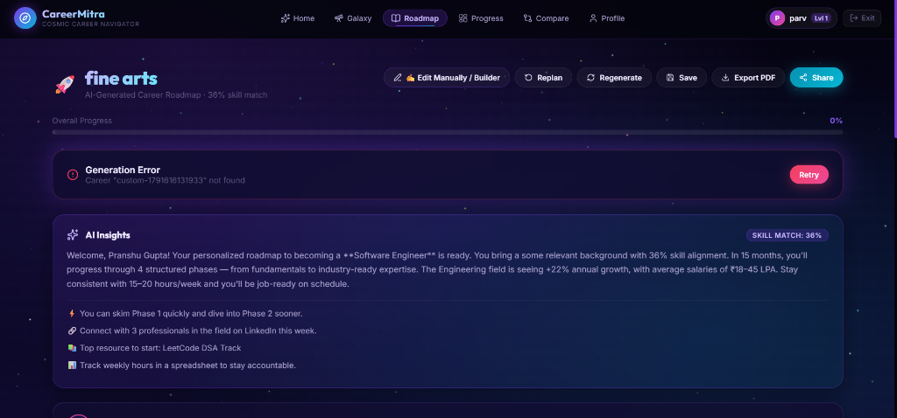
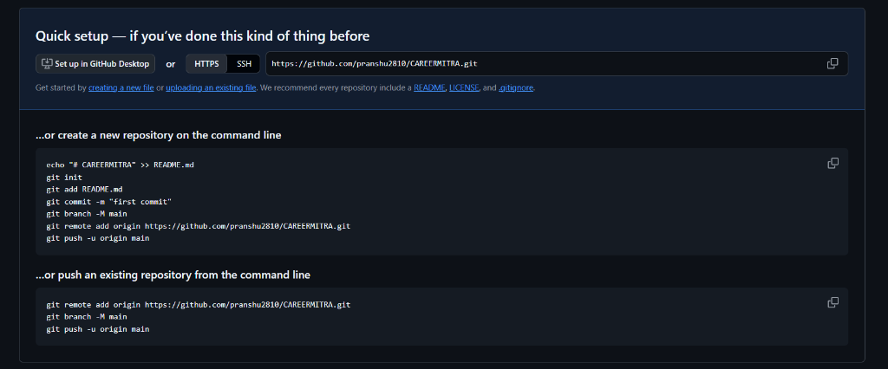
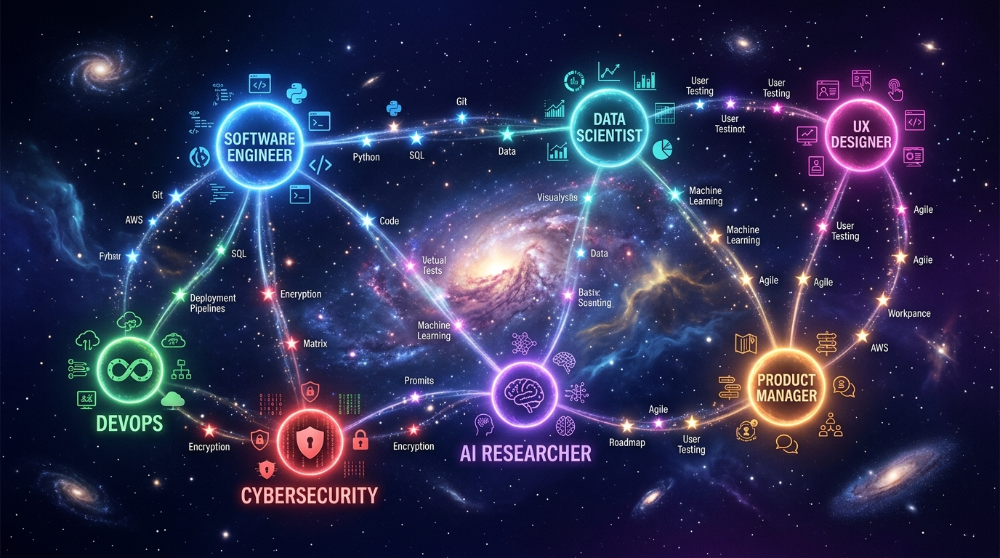
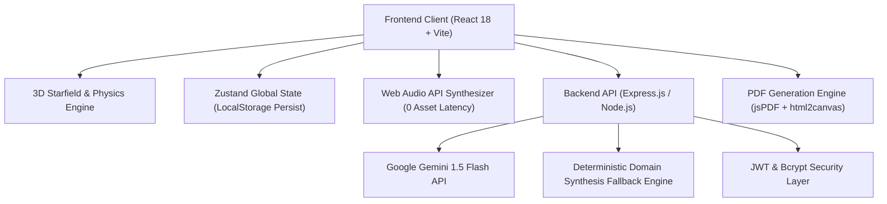

# 🌌 CareerMitra — Next-Gen Gamified AI Career Intelligence & Readiness Platform

[](https://careermitra-3qqu6lxgn-pranshu25.vercel.app)
[](https://careermitra-3qqu6lxgn-pranshu25.vercel.app)

> 🚀 **Live Deployment URL:** [https://careermitra-3qqu6lxgn-pranshu25.vercel.app](https://careermitra-3qqu6lxgn-pranshu25.vercel.app)
>
> **Navigate Your Career Galaxy** — An interactive, 3D gamified career intelligence universe featuring celestial constellation pathfinding, hyper-personalized AI roadmaps, 30-MCQ domain skill assessments, major career readiness certification, and 5 production capstone project portals.

---

## 📸 Prototype & Visual Showcase

| 🌌 3D Interactive Career Galaxy | 🗺️ AI Roadmap & Milestone Engine |
|:---:|:---:|
|  |  |

| ⚡ Gamified 30-MCQ Skill Assessments | 🚀 Capstone Project Portals |
|:---:|:---:|
|  |  |

---

## 🔑 Test Login Credentials (Instant Demo Access)

🌐 **Live Demo Access:** [https://careermitra-3qqu6lxgn-pranshu25.vercel.app](https://careermitra-3qqu6lxgn-pranshu25.vercel.app)

For judges, evaluators, and reviewers to test the complete platform immediately:

| Access Method | Email / Identifier | Password | Access Level |
|---|---|---|---|
| **Pre-Seeded Demo Account** | `demo@careermitra.ai` | `password123` | Full Access (Level 3, 450 XP, Verified Profile) |
| **Instant Guest Access** | *Click "Continue as Guest"* | *No password required* | Instant 1-Click Onboarding |
| **New Account** | *Register any email* | *Your choice* | Fresh onboarding with +100 starting XP |

> 💡 **Tip:** On the landing page or navbar, click **Sign In** and use the credentials above, or simply tap **"⚡ Continue as Guest (Instant Access)"** for zero-friction exploration!

---

## 💻 How to Run the Project in CMD / Terminal

### Prerequisites
- **Node.js** (v18.0.0 or higher recommended)
- **npm** (v9.0.0 or higher)

### 1. Clone the Repository
```cmd
git clone https://github.com/pranshu2810/CAREERMITRA.git
cd CAREERMITRA
```

### 2. Install Dependencies
```cmd
npm install
```

### 3. Run Both Frontend & Backend

You can run both concurrently or in separate terminal windows:

#### Option A: Quick Dual Launch (Two Terminals)
**Terminal 1 (Backend API Server):**
```cmd
node server.js
```
*Backend runs at:* **http://localhost:3000** (Health check: http://localhost:3000/api/health)

**Terminal 2 (Vite Frontend):**
```cmd
npm run dev
```
*Frontend runs at:* **http://localhost:5173**

---

#### Option B: Production Build & Preview
```cmd
npm run build
npm run preview
```

### 4. Run Automated Test Verification Suite
```cmd
node test/api.test.js
```
*Verifies 24 automated backend & AI endpoints (Health, Catalog, Roadmaps, Replanning, Comparison, Auth).*

---

### 5. 🚀 Deploying to Vercel (Production Ready)

> 🌐 **Live Deployed App:** [https://careermitra-3qqu6lxgn-pranshu25.vercel.app](https://careermitra-3qqu6lxgn-pranshu25.vercel.app)

CareerMitra is fully configured with [`vercel.json`](vercel.json) and an Express serverless handler at [`api/index.js`](api/index.js) for seamless 1-click Vercel deployment:

1. **Import Repository**: Go to [vercel.com](https://vercel.com) and select **"Add New Project"** → Import **`pranshu2810/CAREERMITRA`**.
2. **Framework Detection**: Vercel automatically detects **Vite** (`dist/` build output).
3. **Environment Variables (Optional)**:
   - `JWT_SECRET`: Custom secure string for signing tokens (has cosmic fallback).
   - `GEMINI_API_KEY`: *(Optional)* For direct Google Gemini 1.5 Flash roadmap synthesis.
4. **Click Deploy**: In ~45 seconds, your live cosmic career platform is active with both the React frontend and all `/api/*` endpoints!

---

## 🌟 Key Features & Capabilities

### 1. 🌌 3D Interactive Career Galaxy & Constellation Canvas
- **3D Perspective Starfield & Parallax Nebula Engine:** 360+ celestial bodies projected in 3D $(X,Y,Z)$ with inertia damping, cursor stardust, and Hyperspace Warp Drive.
- **Relational Constellations:** SVG node graph connecting career clusters by relational strength, displaying real-time market salaries ($110k–$190k / ₹18–45 LPA) and demand growth rates.
- **Career Management:** Delete any career field directly with confirmation, and restore all paths anytime via a dynamic 1-click **"Restore Careers"** button.
- **Custom Career Constellations:** Add any emerging profession (*Fine Arts, Quantum Computing, Robotics, Game Dev*) with automatic domain blueprint synthesis.

### 2. 🗺️ AI-Powered Hyper-Personalized Roadmaps
- **Dynamic Skill-Match Engine:** Compares candidate skills against target role requirements, automatically prioritizing gaps as `learn` vs `review`.
- **Dynamic Replanning Slider:** Adjust target duration (3 to 24 months) and watch the AI dynamically redistribute milestone hours and difficulty tiers.
- **Dual-Mode Experience:** Switch seamlessly between **Guided AI Roadmap** and **Manual Roadmap Builder** to add custom phases, milestones, or notes.
- **Native Web Audio Synthesizer:** Real-time oscillator sound design (chimes, warp sweeps, fanfares) with zero external MP3 assets or network latency.
- **PDF Export & Sharing:** Download formatted, print-ready career roadmaps via `html2canvas` and `jsPDF`.

### 3. ⚡ Gamified 30-MCQ Phase Skill Assessments
- **30 Questions After Every Phase:** Dynamically generated domain-calibrated MCQs testing Foundational, Intermediate, and Advanced concepts.
- **Gamified HUD Arena:**
  - Real-time countdown timer with pressure warnings.
  - Combo streak multipliers (`🔥 3x Streak`) with celebratory particle fireworks.
  - **Lifelines:** ⚡ **50:50 Lifeline** (eliminates two wrong answers) and 💡 **AI Hint** (contextual architectural clues).
  - **30-Question Navigator Grid:** Slide-out drawer allowing instant jumps to any question with color-coded status.
  - **Instant Audio Feedback:** Crisp harmonic chimes on correct choices and soft buzzers on incorrect answers.
  - **Detailed Analysis Mode:** Review all 30 questions with comprehensive educational explanations.

### 4. 🏆 Major Final Career Readiness Simulation & Verifiable Certificate
- **Comprehensive 30-Question Capstone Exam:** Scenario-driven exam assessing real-world incident debugging, system architecture, and security tradeoffs.
- **Readiness Scoring:** Computes overall career readiness score (e.g. *93.3% Industry Ready*), awarding +300 XP and the `career_ready` badge.
- **Official Galactic Certificate:** Generates a verifiable digital certificate displaying candidate name, career role, score percentage, and unique verification hash token.

### 5. 🚀 5 Industry Portfolio Capstones & Interactive Portals
- **Curated 5 Flagship Projects per Role:** From *Distributed Raft In-Memory Caches* to *Multimodal Vector Search Engines*.
- **Interactive Project Portal Modal:**
  - Executive summary and real-world business problem solved.
  - Technical architecture blueprints and component specifications.
  - **Interactive Milestone Checklist:** Check off steps as you build; each step claims +30 XP with celebratory fanfare and confetti!
  - **Recruiter-Ready Resume Bullets:** Written in the Google X-Y-Z formula with 1-click clipboard copy.
  - **"Mark Capstone Complete":** Awards +120 XP and unlocks the `project_builder` badge.

### 6. ⚖️ Multi-Role Radar Comparison & Analytics
- Side-by-side radar skill profile analysis for up to 3 careers.
- Comparative compensation distribution and market growth rate bar charts.

---

## 🛠️ Complete Technical Architecture



| Layer | Technology | Purpose |
|---|---|---|
| **Frontend Framework** | React 18, Vite 8 | Ultra-fast client-side reactive rendering and HMR |
| **Styling & Theme** | Vanilla CSS (Glassmorphism design system) | 100% bespoke design control with dark cosmic tokens |
| **Motion & Physics** | Framer Motion 14, Canvas-Confetti | Smooth 60 FPS transitions, spring physics, and confetti |
| **State & Persistence** | Zustand 5 (with `persist` middleware) | Synchronizes roadmaps, assessments, and badges to `localStorage` |
| **Audio Synthesis** | Web Audio API (Native Oscillators) | Low-latency sound design (0 external MP3 files) |
| **Data Visuals** | Recharts 3 | Responsive Radar charts, Bar charts, and Progress meters |
| **Backend API** | Node.js, Express.js | REST endpoints for auth, careers, and roadmapping |
| **AI Intelligence** | Google Gemini 1.5 Flash + Procedural Engine | High-throughput AI roadmap and assessment synthesis |
| **Security** | JWT, bcryptjs | Encrypted session tokens and password hashing |
| **Companion App** | React Native, Expo (`mobile/`) | Cross-platform mobile version sharing unified REST API |

---

## 📁 Repository Directory Structure

```
CareerMitra/
├── data/
│   ├── defaultBlueprints.js      # Core cluster blueprints & fallback data
│   └── users.json                # User database with hashed credentials
├── public/
│   ├── assets/                   # Static icons & hero graphics
│   └── screenshots/              # Prototype demonstration screenshots
│       ├── career_galaxy_hero.jpg
│       ├── roadmap_prototype_1.png
│       └── roadmap_prototype_2.png
├── src/
│   ├── components/
│   │   ├── AssessmentQuizModal.jsx # Gamified 30-MCQ Arena (Lifelines, Timer, Streaks)
│   │   ├── CareerDetailModal.jsx   # Detailed career inspection & delete action
│   │   ├── CareerGalaxy.jsx        # 3D interactive constellation node canvas
│   │   ├── GamificationHUD.jsx     # Badges codex, level telemetry, XP popups
│   │   ├── HoloCard.jsx            # 3D perspective tilt holographic cards
│   │   ├── Navbar.jsx              # Audio toggle, warp speed trigger, profile HUD
│   │   ├── ProjectPortalModal.jsx  # Capstone portal with milestones & resume bullets
│   │   └── StarField.jsx           # 3D canvas starfield & inertia damping engine
│   ├── data/
│   │   └── careers.js              # Career nodes, edges, skills, and salaries
│   ├── pages/
│   │   ├── CompareView.jsx         # Multi-career radar & salary comparison
│   │   ├── LandingView.jsx         # Cosmic landing page with auth triggers
│   │   ├── ProfileView.jsx         # User profile, skills, and target role settings
│   │   ├── ProgressView.jsx        # Activity timeline, XP breakdown, mastery charts
│   │   └── RoadmapView.jsx         # Roadmap milestones, assessments & 5 projects
│   ├── store/
│   │   └── useStore.js             # Global persisted state (Zustand)
│   ├── utils/
│   │   ├── assessmentGenerator.js  # 30-MCQ phase & career readiness generator
│   │   ├── blueprintSynthesizer.js # Procedural generator for custom careers
│   │   ├── domainProjects.js       # 5 production capstone projects per role
│   │   ├── exportUtils.js          # jsPDF and html2canvas PDF export
│   │   ├── roadmapAPI.js           # Adaptive roadmap synthesizer
│   │   └── soundFX.js              # Native Web Audio API sound synthesizer
│   ├── App.jsx                     # Route coordinator & global modals
│   ├── index.css                   # Custom cosmic design system (800+ lines)
│   └── main.jsx                    # Application entry point
├── test/
│   └── api.test.js                 # 24-test automated backend verification suite
├── mobile/                         # React Native / Expo companion app
├── server.js                       # Express backend server with Gemini & synthesis
├── package.json
└── README.md
```

---

## 📡 REST API Reference

| Method | Endpoint | Description | Auth Required |
|---|---|---|---|
| `GET` | `/api/health` | Service health status check | No |
| `POST` | `/api/auth/register` | Register new user with hashed password | No |
| `POST` | `/api/auth/login` | Authenticate and receive JWT token | No |
| `POST` | `/api/auth/guest` | Instant 1-click guest authentication | No |
| `GET` | `/api/auth/me` | Retrieve profile and earned XP | Yes (JWT) |
| `GET` | `/api/careers` | Retrieve all career clusters and paths | No |
| `GET` | `/api/career/:id` | Retrieve detailed career blueprint | No |
| `POST` | `/api/roadmap/generate`| Generate AI roadmap with Gemini / synthesis | Optional |
| `POST` | `/api/roadmap/replan` | Dynamically replan remaining roadmap phases | Optional |

---

## 🏆 Presentation Pitch & Slide Deck Guide

A comprehensive, slide-by-slide presentation deck outline, AI generator prompt for Gamma/Slides, and a 3-minute presenter script are available in:  
📄 **[`presentation_deck_and_pitch.md`](presentation_deck_and_pitch.md)**

---

## 📄 License

MIT © CareerMitra Team
